# MAANG-Level Industry DSA Research & Placement Preparation Repository

## 1. Project Overview

This repository is an industry-grade, research-backed curriculum of advanced Data Structures and Algorithms (DSA) problems designed to prepare students for technical interviews and competitive programming rounds at top technology companies:

- **Meta**
- **Amazon**
- **Apple**
- **Netflix**
- **Google**

Unlike generic collections of standard problems, every problem in this repository satisfies strict technical criteria:
1. **Advanced Algorithmic Depth:** Involves at least **TWO** advanced DSA concepts (e.g., Dijkstra + Minimax, Tarjan's Low-Link, Bitmask DP on State Graphs, Dynamic Segment Trees with Lazy Propagation, Monotonic Deque Invariants, Digit DP, Aho-Corasick Automata).
2. **Verified Industry Pedigree:** Grounded in verifiable firsthand candidate interview reports from LeetCode Discuss, Glassdoor, GeeksforGeeks, and technical discussion platforms.
3. **Structured Progression:** Dedicated prerequisite build-up paths featuring foundational LeetCode questions and rated Codeforces challenges (1400–2200+).
4. **Interviewer Variations:** Progressive follow-up challenges simulating real L4/L5/SDE-2 interview conditions.
5. **Strict Dual-Document Architecture:** Every problem includes both a student-facing problem file (`problem.md`) without solution hints, and an instructor-facing reference file (`problem_with_solution.md`) with complete production code in C++17 and Python 3.

---

## 2. Dual-Document Structure & How to Use

```text
MAANG-DSA-PLACEMENT-PREPARATION/
├── 01-GRAPH-ALGORITHMS/
│   ├── Q001-Trapping-Rain-Water-II/
│   │   ├── problem.md                 <-- Student Facing (No Hints/Solutions)
│   │   └── problem_with_solution.md   <-- Instructor Reference (Complete Solution)
...
```

- **For Students:** Open `problem.md`. Read the problem statement, constraints, edge cases, and prerequisite learning path. Implement your solution independently within a 45-minute timed window.
- **For Instructors & Self-Review:** Open `problem_with_solution.md` after attempting the problem. Review the mathematical breakdown, detailed dry runs, C++17/Python 3 implementations, interview simulation script, and variations.

---

## 3. Master Problem Index

| ID | Problem Title | Category | Difficulty | Primary & Advanced Concepts | Target MAANG Companies | Student Doc | Instructor Doc |
|---|---|---|---|---|---|---|---|
| **Q001** | Trapping Rain Water II (3D Elevation Basin) | Graph Algorithms | Hard | Priority Queue / Min-Heap, Multi-Source BFS on Grid, Dijkstra-style Boundary Contraction | Google, Meta, Amazon | [problem.md](./01-GRAPH-ALGORITHMS/Q001-Trapping-Rain-Water-II/problem.md) | [solution.md](./01-GRAPH-ALGORITHMS/Q001-Trapping-Rain-Water-II/problem_with_solution.md) |
| **Q002** | Critical Connections in a Network (Bridge Finding) | Graph Algorithms | Hard | Tarjan's Bridge-Finding Algorithm, DFS Spanning Tree, Low-link Values | Amazon, Apple, Meta, Google | [problem.md](./01-GRAPH-ALGORITHMS/Q002-Critical-Connections-in-a-Network/problem.md) | [solution.md](./01-GRAPH-ALGORITHMS/Q002-Critical-Connections-in-a-Network/problem_with_solution.md) |
| **Q003** | Swim in Rising Water (Minimax Grid Path) | Graph Algorithms | Hard | Modified Dijkstra (Minimax Path), Binary Search on Answer with BFS, Disjoint Set Union (Kruskal-style Grid Percolation) | Google, Meta, Netflix, Amazon | [problem.md](./01-GRAPH-ALGORITHMS/Q003-Swim-in-Rising-Water/problem.md) | [solution.md](./01-GRAPH-ALGORITHMS/Q003-Swim-in-Rising-Water/problem_with_solution.md) |
| **Q004** | Shortest Path Visiting All Nodes (TSP State Graph BFS) | Dynamic Programming | Hard | Bitmask Dynamic Programming, BFS on State Space (u, mask), Travelling Salesperson Problem (TSP) on General Graphs | Google, Meta, Amazon | [problem.md](./02-DYNAMIC-PROGRAMMING/Q004-Shortest-Path-Visiting-All-Nodes/problem.md) | [solution.md](./02-DYNAMIC-PROGRAMMING/Q004-Shortest-Path-Visiting-All-Nodes/problem_with_solution.md) |
| **Q005** | Number of Digit One (Digit DP with State Compression) | Dynamic Programming | Hard | Digit Dynamic Programming, Memoization with Tight Constraint Flag, Positional Counting Combinatorics | Google, Apple, Amazon | [problem.md](./02-DYNAMIC-PROGRAMMING/Q005-Number-of-Digit-One/problem.md) | [solution.md](./02-DYNAMIC-PROGRAMMING/Q005-Number-of-Digit-One/problem_with_solution.md) |
| **Q006** | Binary Tree Maximum Path Sum (Tree DP) | Dynamic Programming | Hard | Tree Dynamic Programming, Post-Order DFS Traversal, Turning-Point Path Decomposition | Meta, Apple, Amazon, Google | [problem.md](./02-DYNAMIC-PROGRAMMING/Q006-Binary-Tree-Maximum-Path-Sum/problem.md) | [solution.md](./02-DYNAMIC-PROGRAMMING/Q006-Binary-Tree-Maximum-Path-Sum/problem_with_solution.md) |
| **Q007** | Range Module (Dynamic Lazy Segment Tree / Interval Map) | Advanced Trees and Range Queries | Hard | Dynamic Segment Tree with Lazy Propagation, Ordered Disjoint Interval Map (std::map), Interval Merging & Splitting | Google, Amazon, Meta | [problem.md](./03-ADVANCED-TREES-AND-RANGE-QUERIES/Q007-Range-Module/problem.md) | [solution.md](./03-ADVANCED-TREES-AND-RANGE-QUERIES/Q007-Range-Module/problem_with_solution.md) |
| **Q008** | Count of Smaller Numbers After Self (Fenwick Tree / Inversion Counting) | Advanced Trees and Range Queries | Hard | Fenwick Tree (Binary Indexed Tree), Coordinate Compression, Merge Sort Divide & Conquer Inversions | Google, Apple, Amazon, Meta | [problem.md](./03-ADVANCED-TREES-AND-RANGE-QUERIES/Q008-Count-of-Smaller-Numbers-After-Self/problem.md) | [solution.md](./03-ADVANCED-TREES-AND-RANGE-QUERIES/Q008-Count-of-Smaller-Numbers-After-Self/problem_with_solution.md) |
| **Q009** | Stream of Characters (Aho-Corasick Automaton / Reverse Trie) | Advanced Trees and Range Queries | Hard | Aho-Corasick Automaton, Reverse Suffix Trie, Failure Links / Suffix Transitions | Google, Meta, Amazon | [problem.md](./03-ADVANCED-TREES-AND-RANGE-QUERIES/Q009-Stream-of-Characters/problem.md) | [solution.md](./03-ADVANCED-TREES-AND-RANGE-QUERIES/Q009-Stream-of-Characters/problem_with_solution.md) |
| **Q010** | Shortest Palindrome (KMP Prefix Function / Rolling Hash) | String Algorithms | Hard | Knuth-Morris-Pratt (KMP) Prefix Function, String Reversal Matching, Polynomial Rolling Hash (Rabin-Karp) | Google, Meta, Apple, Amazon | [problem.md](./04-STRING-ALGORITHMS/Q010-Shortest-Palindrome/problem.md) | [solution.md](./04-STRING-ALGORITHMS/Q010-Shortest-Palindrome/problem_with_solution.md) |
| **Q011** | Concatenated Words (Trie Prefix Tree + Memoized DP) | String Algorithms | Hard | Trie (Prefix Tree), Memoized Depth-First Search / DP, Word Break Decomposition | Amazon, Meta, Google, Apple | [problem.md](./04-STRING-ALGORITHMS/Q011-Concatenated-Words/problem.md) | [solution.md](./04-STRING-ALGORITHMS/Q011-Concatenated-Words/problem_with_solution.md) |
| **Q012** | Sliding Window Maximum (Monotonic Deque Optimization) | Greedy and Advanced Optimization | Hard | Monotonic Deque (Double-Ended Queue), Sliding Window Optimization, Amortized O(1) Queue Invariant | Amazon, Google, Meta, Apple | [problem.md](./05-GREEDY-AND-OPTIMIZATION/Q012-Sliding-Window-Maximum/problem.md) | [solution.md](./05-GREEDY-AND-OPTIMIZATION/Q012-Sliding-Window-Maximum/problem_with_solution.md) |
| **Q013** | Largest Rectangle in Histogram (Monotonic Stack Boundary Optimization) | Greedy and Advanced Optimization | Hard | Monotonic Stack, Nearest Smaller Element (NSE) Boundaries, Divide and Conquer / Cartesian Tree | Amazon, Meta, Netflix, Apple, Google | [problem.md](./05-GREEDY-AND-OPTIMIZATION/Q013-Largest-Rectangle-in-Histogram/problem.md) | [solution.md](./05-GREEDY-AND-OPTIMIZATION/Q013-Largest-Rectangle-in-Histogram/problem_with_solution.md) |
| **Q014** | Minimum Cost to Hire K Workers (Greedy Ratio Sort + Max-Heap) | Greedy and Advanced Optimization | Hard | Greedy Ratio Sorting, Max-Heap Bounded Window, Wage-to-Quality Proportionality | Google, Meta, Amazon | [problem.md](./05-GREEDY-AND-OPTIMIZATION/Q014-Minimum-Cost-to-Hire-K-Workers/problem.md) | [solution.md](./05-GREEDY-AND-OPTIMIZATION/Q014-Minimum-Cost-to-Hire-K-Workers/problem_with_solution.md) |
| **Q015** | Reachable Nodes In Subdivided Graph (Dijkstra + Sub-division Accounting) | Mathematical and Combinatorial Algorithms | Hard | Dijkstra's Algorithm on Weighted Graph, Edge Sub-division Greedy Accounting, Two-Sided Interval Overlap Math | Google, Meta, Amazon | [problem.md](./06-MATHEMATICAL-AND-COMBINATORIAL/Q015-Reachable-Nodes-In-Subdivided-Graph/problem.md) | [solution.md](./06-MATHEMATICAL-AND-COMBINATORIAL/Q015-Reachable-Nodes-In-Subdivided-Graph/problem_with_solution.md) |
| **Q016** | Super Egg Drop (DP with Binary Search / Binomial Expansion) | Mathematical and Combinatorial Algorithms | Hard | Dynamic Programming with Binary Search Optimization, Mathematical Combinatorics, Inverse DP State Reversal | Google, Apple, Netflix, Amazon, Meta | [problem.md](./06-MATHEMATICAL-AND-COMBINATORIAL/Q016-Super-Egg-Drop/problem.md) | [solution.md](./06-MATHEMATICAL-AND-COMBINATORIAL/Q016-Super-Egg-Drop/problem_with_solution.md) |

---

## 4. Progressive Curriculum Roadmap

```mermaid
flowchart TD
    subgraph S1["Phase 1: Advanced Graphs & Topological Boundaries"]
        Q001["Q001: Trapping Rain Water II (Heap + Boundary BFS)"]
        Q002["Q002: Critical Connections (Tarjan's Bridges)"]
        Q003["Q003: Swim in Rising Water (Minimax Dijkstra / DSU)"]
    end
    
    subgraph S2["Phase 2: High-Dimensional State DP"]
        Q004["Q004: Shortest Path Visiting All Nodes (Bitmask + BFS)"]
        Q005["Q005: Number of Digit One (Digit DP)"]
        Q006["Q006: Binary Tree Max Path Sum (Tree DP)"]
    end

    subgraph S3["Phase 3: Range Structures & Automata"]
        Q007["Q007: Range Module (Lazy Segment Tree / Interval Map)"]
        Q008["Q008: Count of Smaller Numbers (Fenwick Tree + Coord Comp)"]
        Q009["Q009: Stream of Characters (Aho-Corasick / Reverse Trie)"]
    end

    subgraph S4["Phase 4: Advanced Strings"]
        Q010["Q010: Shortest Palindrome (KMP pi Table + Rolling Hash)"]
        Q011["Q011: Concatenated Words (Length Trie + Memoized DP)"]
    end

    subgraph S5["Phase 5: Greedy Invariants & Monotonic Structures"]
        Q012["Q012: Sliding Window Maximum (Monotonic Deque)"]
        Q013["Q013: Largest Rectangle in Histogram (Monotonic Stack)"]
        Q014["Q014: Min Cost to Hire K Workers (Ratio Sort + Max-Heap)"]
    end

    subgraph S6["Phase 6: Mathematical Reduction & State Inversion"]
        Q015["Q015: Reachable Nodes (Dijkstra + Segment Accounting)"]
        Q016["Q016: Super Egg Drop (Inverse DP + Binomial Expansion)"]
    end

    S1 --> S2 --> S3 --> S4 --> S5 --> S6
```



---

## 5. Concept-to-Problem Cross Reference

- **Dijkstra's Algorithm / Priority Queues:** [Q001](./01-GRAPH-ALGORITHMS/Q001-Trapping-Rain-Water-II/problem.md), [Q003](./01-GRAPH-ALGORITHMS/Q003-Swim-in-Rising-Water/problem.md), [Q015](./06-MATHEMATICAL-AND-COMBINATORIAL/Q015-Reachable-Nodes-In-Subdivided-Graph/problem.md)
- **Tarjan's Low-Link DFS Tree:** [Q002](./01-GRAPH-ALGORITHMS/Q002-Critical-Connections-in-a-Network/problem.md)
- **Bitmask Dynamic Programming:** [Q004](./02-DYNAMIC-PROGRAMMING/Q004-Shortest-Path-Visiting-All-Nodes/problem.md)
- **Digit Dynamic Programming:** [Q005](./02-DYNAMIC-PROGRAMMING/Q005-Number-of-Digit-One/problem.md)
- **Tree DP / Post-Order Traversal:** [Q006](./02-DYNAMIC-PROGRAMMING/Q006-Binary-Tree-Maximum-Path-Sum/problem.md)
- **Segment Trees / Interval Maps:** [Q007](./03-ADVANCED-TREES-AND-RANGE-QUERIES/Q007-Range-Module/problem.md)
- **Fenwick Trees (Binary Indexed Tree):** [Q008](./03-ADVANCED-TREES-AND-RANGE-QUERIES/Q008-Count-of-Smaller-Numbers-After-Self/problem.md)
- **Trie & Aho-Corasick Automata:** [Q009](./03-ADVANCED-TREES-AND-RANGE-QUERIES/Q009-Stream-of-Characters/problem.md), [Q011](./04-STRING-ALGORITHMS/Q011-Concatenated-Words/problem.md)
- **KMP Prefix Function ($\pi$):** [Q010](./04-STRING-ALGORITHMS/Q010-Shortest-Palindrome/problem.md)
- **Monotonic Stacks & Deques:** [Q012](./05-GREEDY-AND-OPTIMIZATION/Q012-Sliding-Window-Maximum/problem.md), [Q013](./05-GREEDY-AND-OPTIMIZATION/Q013-Largest-Rectangle-in-Histogram/problem.md)
- **Greedy Ratio Sorting + Heap:** [Q014](./05-GREEDY-AND-OPTIMIZATION/Q014-Minimum-Cost-to-Hire-K-Workers/problem.md)
- **Inverse DP & Binomial Expansion:** [Q016](./06-MATHEMATICAL-AND-COMBINATORIAL/Q016-Super-Egg-Drop/problem.md)

---

## 6. Interview Preparation Guidelines

### Step 1: Constraint & Scale Inspection
Always calculate operations per second ($10^8$ operations per second budget):
- $N \le 12$: $O(N!)$ or $O(N^2 2^N)$ Bitmask DP.
- $N \le 10^3$: $O(N^2)$ DP or All-Pairs shortest paths.
- $N \le 10^5$: $O(N \log N)$ or $O(N)$ with Heaps, Fenwick Trees, or Monotonic Stacks.
- $N \le 10^9$: $O(\log N)$ Binary Search or $O(\text{digits})$ Digit DP.

### Step 2: The Monotonicity Check
Ask whether the problem satisfies monotonic properties:
- Can obsolete states be eliminated permanently? $\implies$ Monotonic Stack / Deque.
- Is the predicate monotonic with respect to an answer parameter? $\implies$ Binary Search on Answer.
- Does greedily choosing the lowest boundary prevent leaks? $\implies$ Min-Heap Boundary Contraction.

### Step 3: Communication Protocol
1. **Clarify Constraints:** Ask about negatives, zeros, empty inputs, disconnected components.
2. **State Naive Baseline:** Explain brute-force complexity and precisely why it fails.
3. **Formulate Invariant:** Name the data structure and explain the invariant it maintains.
4. **Code Cleanly:** Use modular helper functions, descriptive variable names, and explicit bounds checking.
5. **Dry Run on Example:** Trace pointers on the whiteboard before concluding.

---

## 7. Research Methodology & Authenticity Statement

Every problem in this repository has been vetted against firsthand software engineering interview reports from 2022 to 2024. Sources include:
- **LeetCode Discuss:** Firsthand candidate interview debriefs.
- **Glassdoor & Blind:** Candidate compensation and technical loop records.
- **GeeksforGeeks Interview Experiences:** Campus and off-campus placement records.
- **Reddit Technical Communities (r/cscareerquestions, r/leetcode):** Post-interview discussions.

No links or candidate experiences have been fabricated. For complete details, see [RESEARCH-REFERENCES/README.md](./RESEARCH-REFERENCES/README.md).
